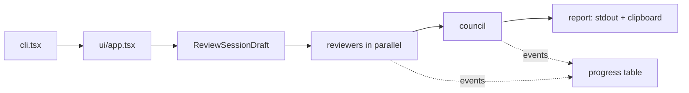

# Architecture

Usage: [README.md](README.md).

## Flow

The wizard ends in a validated `ReviewSessionDraft` ([`src/domain/review-session.ts`](src/domain/review-session.ts)); everything after it reads only that object.

## Modules

| Folder | Owns |
|---|---|
| [`src/domain`](src/domain) | Zod schemas and types for the session |
| [`src/process`](src/process) | Spawning CLIs with argument arrays, never a shell |
| [`src/providers`](src/providers) | Per CLI: login check, model catalog |
| [`src/git`](src/git), [`src/scope`](src/scope) | Read-only Git, review scope, secret file exclusion |
| [`src/execution`](src/execution) | One agent: launch flags, event parsing, timeout, cancel, cleanup |
| [`src/review`](src/review) | One run: frozen diff, agent messages, reviewers then council, report output |
| [`src/ui`](src/ui) | Ink screens; colors only from [`theme.ts`](src/ui/theme.ts), ANSI names so the terminal theme sets shades |

Services reach the UI through `AppServices` ([`src/app-services.ts`](src/app-services.ts)); tests pass fakes.

## Providers

Settings verified against the live CLIs.

| | Claude Code | Codex |
|---|---|---|
| Catalog | `initialize` request on `claude -p --input-format stream-json` | `model/list` on `codex app-server` |
| Run | `claude -p --output-format stream-json` | `codex exec --json -` |
| Instructions / message | `--append-system-prompt` / stdin | `-c developer_instructions=…` / stdin |
| Read-only | `--tools Read,Grep,Glob`, `--strict-mcp-config`, `--permission-mode dontAsk` | `--sandbox read-only`, `approval_policy="never"`, `mcp_servers={}`, extras off |
| Repository config | `disableAllHooks`, empty `apiKeyHelper`: both run shell commands; its `CLAUDE.md` and skills still load | `hooks` off |
| Secret files | `Read(**/…)` deny rules from [`excluded-files.ts`](src/scope/excluded-files.ts); `.env.example` is denied too | Only the prompt asks; the sandbox reads the whole disk |
| What remains | Nothing; without `--strict-mcp-config` claude.ai connectors stay | A read-only shell, its only way to read files; `code_mode_host` must stay on |

Global `~/.claude/CLAUDE.md` and `~/.codex/AGENTS.md` reach the agents on purpose. A new provider needs an id in `providerIds`, an adapter in `src/providers`, and a process builder and line parser in [`agent-commands.ts`](src/execution/agent-commands.ts).

## Agent run

[`run-agent-process.ts`](src/execution/run-agent-process.ts):

- **Process group**: agents start detached; timeout, cancel and exit stop the whole group (`SIGTERM`, `SIGKILL` after 5 s); once the CLI exits, whatever is left in its group gets `SIGKILL`. [`shutdown.ts`](src/shutdown.ts) also stops them and removes temp folders on `Ctrl+C`, `SIGHUP`, `SIGINT` and `SIGTERM`, then prints a summary where the terminal remains; a `SIGKILL` of the app leaves agents running.
- **Result**: the final message of a completed turn. No report, an agent error or an early exit is a failure, never an empty review.
- **Progress**: events become phases (`starting`, `reading`, `writing`, `done`, `failed`) plus a read count.

## Review run

[`run-review.ts`](src/review/run-review.ts):

1. Freezes the diff of tracked changes in a temp folder; new files are listed to read in full.
2. Numbers reviewers in table order (provider, model, effort) so the council report matches.
3. Runs reviewers in parallel, then the council with every report, failed ones included; no council if all fail.
4. Trims text before the report title; [`print-outcome.ts`](src/print-outcome.ts) formats it with Prettier (code blocks untouched), prints and copies it.

## Testing

| Layer | How |
|---|---|
| Parsing, scope, catalogs, formatting | Recorded or hand-made samples |
| Git, CLI status | Fake `RunCommand` |
| Process runner, signal cleanup | Real child processes acting as a CLI |
| Review run | Fake `runAgent` and workspace |
| Wizard | `ink-testing-library` flows with fake services |

Live checks use the cheapest models at the lowest effort and are not part of `npm test`.
