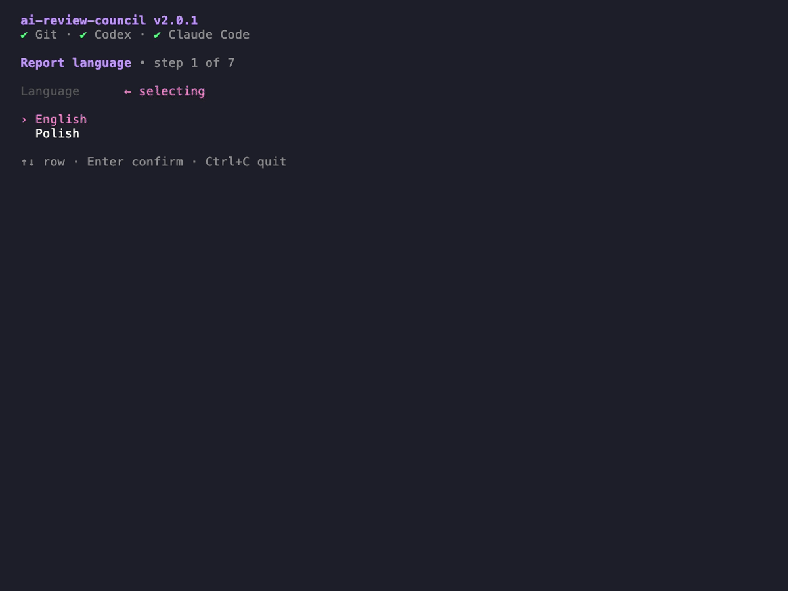

# ai-review-council

Runs independent AI reviewers on a code change.

A council agent verifies their findings and writes one Markdown report, previewed in the terminal, ready to copy or open.

Similar tools usually bill per token through provider APIs. This one runs locally on your logged-in AI coding agents, within your subscriptions' 5-hour and weekly limits.

Docs:

- [CHANGELOG.md](CHANGELOG.md)
- [ARCHITECTURE.md](ARCHITECTURE.md)

## Demo



## Requirements

- macOS
- Node.js
- `git`
- `codex` and/or `claude` on `PATH`, logged in

## Run

```bash
# install
npm install -g @twistezo/ai-review-council

# run with optional args
ai-review-council --dir ~/projects/my-app --lang pl --scope codebase --reviewers 2

```

| Option            | Value                                  | Default |
| ----------------- | -------------------------------------- | ------- |
| `-d, --dir`       | folder inside a Git repository         | -       |
| `-l, --lang`      | `en`, `pl`                             | `en`    |
| `-s, --scope`     | `uncommitted`, `codebase`, commit hash | -       |
| `-r, --reviewers` | 1 to 8                                 | -       |
| `-t, --timeout`   | minutes per agent, 1 to 30             | `10`    |

## Develop

```bash
npm install
npm run dev
npm test
npm run typecheck
npm run build # dist/
```
